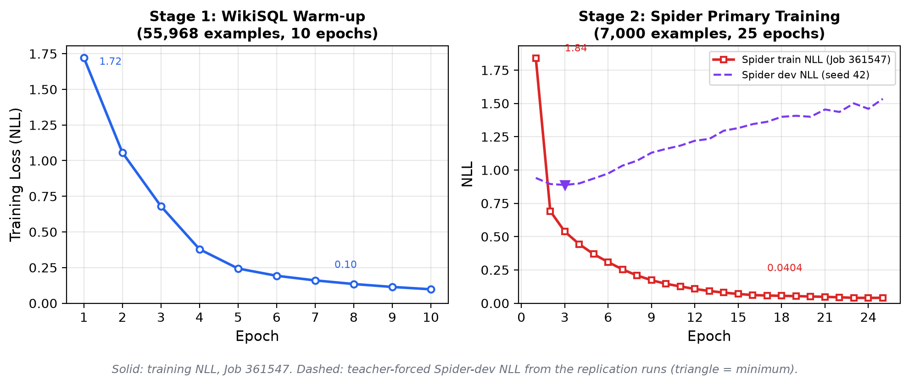

**Course:** CS F429 Natural Language Processing, BITS Pilani  
**Component:** Part 2 Report (Classical Baselines, Evaluation Protocol, Results and Error Analysis)

## Abstract

We formulate cross-domain Text-to-SQL and build an execution-based evaluation harness for Spider (multi-table, unseen databases) and WikiSQL (single-table). Two classical baselines are compared: a deterministic template parser and a two-stage pointer-generator BiLSTM sequence-to-sequence model. All Spider numbers are reported with the official Spider evaluator (exact-set match and execution accuracy), 95% confidence intervals and paired McNemar tests. Every inference fix was developed on Spider dev and frozen before a single run on the held-out Spider test set (2,147 questions, 40 databases disjoint from train and dev).

On **Spider test**, the final LSTM configuration reaches **7.2% official execution accuracy** and **5.5% official exact-set match**. The template parser reaches 9.5% and 0.0%; its 0% EM is a formatting artefact, and it reaches 6.7% once its double-quoted identifiers are unquoted. On strict execution the final LSTM and the template differ on 93 vs 82 test questions (McNemar p = 0.450), and the fixes improve over the as-submitted decoding on 8 vs 1 questions (p = 0.039). On Spider dev the LSTM and the template are statistically tied (McNemar p = 0.58). Both baselines almost entirely fail on the stated core objective, multi-table queries (1.83% [0.9%, 3.6%] strict EX for the LSTM on dev). Most LSTM failures are schema-linking errors: identifier recall is 40.4%, and 690 of 746 invalid queries reference a nonexistent column. A per-epoch dev-loss curve shows the model starts overfitting after about three Spider epochs, although training continued for 25. We also correct the original draft's diagnosis of the WikiSQL collapse: it was a rendering defect, not catastrophic forgetting. The Stage-1 checkpoint, which never saw Spider, fails in the same way, and fixing the rendering raises its WikiSQL execution accuracy from 0.04% to (re-decode pending).

**Changes from the earlier draft.** An internal review found several problems with the earlier draft, and this version fixes them. The comparison now uses the official evaluator, an untouched test split, confidence intervals and significance tests. The training hyper-parameters reported earlier did not match the code; they now do. The literature comparison band of "3.2–5.4%" did not appear in the cited paper; the paper's actual Table 2 rows are now quoted. The "catastrophic forgetting" claim is withdrawn. Section 4.11 lists every correction.

---

## Section (a): Introduction and Task Formulation

### 1.1 Motivation
Relational databases hold most structured enterprise and scientific data. Writing SQL against them requires knowing SQL syntax, relational operations (projection, selection, grouping, joins) and the exact table and column names of each schema. Text-to-SQL removes this barrier by translating a natural-language question into an executable query, giving non-technical users conversational access to structured data.

### 1.2 Core challenges
1. **Schema linking.** Questions rarely use exact identifiers. In *"Which airports are in Los Angeles?"*, the phrase "airports" must be linked to table `airports`, "Los Angeles" to a value of column `City`, and the answer to `AirportName`.
2. **Compositional structure.** Multi-table queries need joins along foreign keys, nested subqueries, `GROUP BY`/`HAVING`, ordering and set operations.
3. **Cross-domain generalisation.** Test databases are unseen during training, so the model cannot memorise identifiers. It must read the schema supplied at inference time.
4. **Executable validity.** A single unknown column or unquoted literal makes SQLite reject the query, so a nearly-correct token sequence can still score zero.

### 1.3 Formulation
Given a question $Q=(q_1,\dots,q_m)$ and a schema $\mathcal{S}=(\mathcal{T},\mathcal{C},\mathcal{E})$ of tables, columns and foreign-key edges, produce SQL $Y=(y_1,\dots,y_n)$ such that executing $Y$ on the database returns the intended result:
$$\hat{Y}=\arg\max_Y \prod_{t=1}^{n} P(y_t\mid y_{<t},Q,\mathcal{S}).$$

---

## Section (b): Literature Survey

### 2.1 Rule-based semantic parsing
PRECISE (Popescu et al., 2003) maps words to database elements through bipartite matching and guarantees precision on the questions it accepts, but its recall drops sharply outside its patterns. SCFG (Wong and Mooney, 2007) and CCG (Zettlemoyer and Collins, 2005) parsers induce logical forms but need domain lexicons and do not transfer across schemas.

### 2.2 Neural sequence-to-sequence parsing
Encoder–decoder LSTMs (Sutskever et al., 2014) with attention (Bahdanau et al., 2015) treat Text-to-SQL as translation. Two weaknesses matter here. First, identifiers and literals are often out of vocabulary. Second, unconstrained decoders emit ungrammatical or schema-inconsistent SQL.

### 2.3 Pointer and copy mechanisms
Pointer Networks (Vinyals et al., 2015) and Pointer-Generator Networks (See et al., 2017) mix a vocabulary distribution with a copy distribution over the input:
$$P(w)=p_{\text{gen}}P_{\text{vocab}}(w)+(1-p_{\text{gen}})\sum_{i:x_i=w}a^t_i .$$
On WikiSQL, Seq2SQL (Zhong et al., 2017) and SQLNet (Xu et al., 2017) combine pointing with sketch-based slot filling.

### 2.4 Spider and its baselines
Spider (Yu et al., 2018) has 10,181 questions and 5,693 unique queries over 200 databases in 138 domains, split so that test databases are unseen. **Table 2 of Yu et al. (2018)** reports exact-matching accuracy on the *database split*:

| Model (Yu et al., 2018, Table 2, database split) | Test EM | Dev EM |
|---|---:|---:|
| Seq2Seq | 3.7% | 1.9% |
| Seq2Seq + Attention | 4.8% | 1.8% |
| Seq2Seq + Copying | 5.3% | 4.1% |
| SQLNet | 12.4% | 10.9% |
| TypeSQL | 8.2% | 8.0% |

These numbers come from the original 2018 release and evaluator, which ignored literal values. They give an order-of-magnitude reference, not a like-for-like comparison. Later systems close the gap through relation-aware schema encoding (RAT-SQL; Wang et al., 2020), constrained decoding (PICARD; Scholak et al., 2021), and schema ranking with pre-trained seq2seq models (RESDSQL; Li et al., 2023). Our Part 2 model belongs to the Seq2Seq+Copying family.

---

## Section (c): Datasets, Preprocessing and Serialisation

### 3.1 Datasets and splits

| | WikiSQL (Zhong et al., 2017) | Spider (Yu et al., 2018) |
|---|---|---|
| Role | Stage-1 warm-up and single-table sanity check | Primary cross-domain benchmark |
| Size (release files) | 80,654 questions; 26,531 table entries in `*.tables.jsonl` (the paper reports 24,241 tables) | 7,000 train / 1,034 dev / 2,147 test questions |
| Databases | One table per question | 140 train / 20 dev / 40 test databases, pairwise disjoint (verified) |
| Operations | `SELECT`, one aggregate, `AND` conditions | Joins, `GROUP BY`, `HAVING`, `ORDER BY`, `LIMIT`, nesting, set operations |

**Per-split retention.** All splits are loaded through the typed loaders in `data/spider.py` and `data/wikisql.py`. These record an explicit exclusion event for any example with a missing question, gold SQL, schema or database file.

| Split | Source | Retained | Excluded (reason) |
|---|---:|---:|---|
| WikiSQL train | 56,355 | 55,968 used in Stage 1 | first 56,000 rows loaded (`--train-limit 56000`); 32 excluded |
| WikiSQL dev | 8,421 | 8,415 | 6 (`unsupported_query_structure`: the loader's single-table filter rejected them) |
| Spider train | 7,000 | 7,000 | 0 |
| Spider dev | 1,034 | 1,034 | 0 |
| Spider test | 2,147 | 2,147 | 0 |

**Spider difficulty distribution** (official `eval_hardness`, reimplemented in `data/spider.py` and cross-checked against the official evaluator's counts): dev has 248 easy, 446 medium, 174 hard and 166 extra-hard examples; test has 470 easy, 857 medium, 463 hard and 357 extra-hard (1,100 single-table, 908 multi-table, 139 nested).

**Query-structure categories** (`_query_structure` in `data/spider.py`) are rule-based on the gold SQL text. A query goes to *multi-table* if it contains `JOIN`, `UNION`, `INTERSECT` or `EXCEPT`. Otherwise it goes to *other (nested)* if it contains more than one `SELECT`, and otherwise to *single-table*. The first matching rule wins, so a query with both a join and a subquery is counted as multi-table, and set operations count as multi-table even over one table. Dev has 544 single-table, 438 multi-table and 52 nested examples.

### 3.2 Schema serialisation
`data/schema.py` serialises each schema deterministically, with tables and columns sorted:

```text
database: concert_singer
table: singer
columns:
  - Age [number]
  - Country [text]
  - Singer_ID [number] [PRIMARY KEY]
foreign_keys:
  - singer_in_concert.Singer_ID -> singer.Singer_ID
```

The encoder input is `<bos> question <schema_sep> schema <eos>`, where both parts are tokenised by the regex lexer in `lstm/preprocessing.py`. Column *types* (`text`, `number`) and markup words (`table`, `columns`) become ordinary copyable source tokens. Section 4.8 shows this was the largest single source of invalid SQL.

### 3.3 Tokenisation and vocabulary
- **Lexer.** It keeps SQL punctuation and operators, splits `t1.col` into `t1 . col`, upper-cases SQL keywords and lower-cases everything else. A quoted literal becomes one unquoted, lower-cased token (`'United States'` → `united states`).
- **Vocabulary.** Every token in the Stage-1 and Stage-2 *training* questions, schemas and SQL, with no frequency threshold: **102,463 types** (`training_meta.json`). Dev and test are never read when building the vocabulary.
- **Copy targets.** Each example extends the vocabulary with its out-of-vocabulary source tokens. A gold SQL token resolves to the fixed vocabulary first, then to a source copy, else to `<unk>`.

### 3.4 Worked preprocessing example
This is the output of `scripts/show_preprocessing.py`, which runs the real pipeline on dev example `spider-dev-4`:

```text
Question : What is the average, minimum, and maximum age of all singers from France?
Tokens   : what is the average minimum and maximum age of all singers from france   (13)
Schema   : database: concert_singer / table: concert / columns: - Stadium_ID [text] ...
           (34 lines, 4 tables)
Encoder  : <bos> what is ... france <schema_sep> database concert_singer table concert
           columns ... <eos>   (93 tokens)
Gold SQL : SELECT avg(age) , min(age) , max(age) FROM singer WHERE country = 'France'
Target   : SELECT AVG ( age ) , MIN ( age ) , MAX ( age ) FROM singer WHERE country = france
           (every token resolves to the fixed vocabulary; 6 source tokens are copy-only)
```

Three effects are visible. Punctuation is dropped from the question. The literal `'France'` loses its quotes and its case: it becomes the token `france`, so the decoder can only emit `france`. That is why §4.4 restores the surface form from the question at inference. The schema's column *types* (`text`) sit in the encoder input right next to the column names.

### 3.5 Corpus statistics (as tokenised for the model)

| Split | Examples | DBs | Question tokens | SQL tokens | Encoder tokens (max; > 256) | Tables / columns per schema | Target tokens: vocab / copy / unk |
|---|---:|---:|---:|---:|---:|---:|---:|
| Train | 7,000 | 140 | 12.8 | 21.7 | 136 (899; 556) | 6.0 / 32.5 | 100.0% / 0.0% / 0.0% |
| Dev | 1,034 | 20 | 12.4 | 21.5 | 104 (242; 0) | 4.5 / 24.8 | 90.9% / 8.7% / 0.4% |
| Test | 2,147 | 40 | 12.5 | 22.6 | 100 (278; 99) | 4.9 / 20.9 | 91.8% / 7.7% / 0.5% |

**The key observation is that the copy mechanism is never trained.** The vocabulary contains every training token, so on Spider train *every* target token can be generated from the fixed vocabulary, and the copy path receives no supervision. On dev and test, 8.7% and 7.7% of target tokens can *only* be produced by copying: unseen table names, column names and values. The model therefore meets the exact case the pointer mechanism exists for only at test time, which helps explain the schema-linking failures in §4.9. The Part 3 remedy is to keep schema identifiers out of the fixed vocabulary, or apply a frequency threshold, so that copying is learned.

### 3.6 Dataset limitations
- **Spider.**
  - *Paraphrase pairs:* most queries appear with two phrasings, which inflates in-domain accuracy. Our dev and test splits are database-disjoint, so this does not leak across splits.
  - *Coverage:* the data is English only and concentrated in college, business and entertainment schemas. Dev has only 20 databases, so per-database variance is high.
  - *Small databases:* these allow coincidental execution matches; §4.9 shows a template example.
  - *Annotation conventions:* gold SQL uses inconsistent quoting (`"blues"` vs `'France'`), stray trailing semicolons and mixed identifier case. These break string match but not execution or exact-set match.
  - *Data quality:* one database (`wta_1`) stores non-UTF-8 text.
  - *Difficulty imbalance:* 43% of dev is medium, and extra-hard is only 16%.
- **WikiSQL.**
  - Single-table only, with one aggregate and `AND`-only conditions.
  - Values are stored as text, column names contain spaces and punctuation, and it is known to contain noisy annotations.
  - It therefore checks pipeline mechanics, not compositional parsing.

---

## Section (d): Methods, Evaluation Protocol, Results and Error Analysis

### 4.1 Baseline 1: deterministic template parser
`baselines/template.py` matches question tokens to table and column names, detects numeric and quoted literals, comparison phrases, aggregation cues (`how many` → `COUNT`, `average` → `AVG`), `DISTINCT` and ordering cues, and fills a single-table template. It never generates joins. When it finds no confident single-table interpretation it **abstains** with an empty string. In the current code it abstains on **92 of 1,034** dev questions (8.9%) and 208 of 2,147 test questions. Every abstention counts as invalid SQL. *(The Job 361547 run used an earlier revision that never abstained; its EX was identical, 60/1,034.)* Apart from abstentions the template produced no SQLite errors, so its low invalid rate reflects conservative, single-table output.

### 4.2 Baseline 2: pointer-generator BiLSTM
`lstm/model.py` (values from `TrainingConfig` and `training_meta.json`):

- **Encoder:** 2-layer bidirectional LSTM. Embedding 256, hidden 256 per direction, so 512-d concatenated states. Packed sequences. Training inputs are truncated at 256 tokens, which cuts 556 of the 7,000 Spider training inputs and hides their alphabetically-last tables. Inference does not truncate: no dev input exceeds 242 tokens, but 99 of 2,147 test inputs do (maximum 278). This train/inference mismatch is a known limitation.
- **Decoder:** 2-layer LSTM with hidden size 512, initialised from projected final encoder states. The input is $[\text{emb}(y_{t-1});\,c_{t-1}]$.
- **Attention:** additive, $e_{t,i}=v^\top\tanh(W_h h_i+W_s s_t)$.
- **Copy gate:** $p_{\text{gen}}=\sigma(W[s_t;c_t;\text{emb}(y_{t-1})]+b)$, mixing $P_{\text{vocab}}$ with the attention-weighted copy distribution as in §2.3.
- **Dropout** 0.2. **Decoding:** greedy, at most 128 tokens, with `<pad>`/`<unk>` masked.

### 4.3 Training (HPC Job 361547)
Hardware: one NVIDIA RTX PRO 6000 Blackwell MPS slice (50%), 4 CPUs and 80 GB RAM. The whole job, training plus evaluation, took 50 min of wall time (04:41 to 05:31 IST).

- **One Adam optimiser** with constant learning rate $10^{-3}$, batch 64, gradient-norm clipping at 1.0, teacher forcing ratio 1.0, seed 42 and per-epoch shuffling with seed $42+\text{epoch}$. *The earlier draft reported warm-up, cosine decay, a Stage-2 learning rate of $5\times10^{-4}$ and dropout 0.3. None of these exist in the code; those statements were wrong and have been removed.*
- **Stage 1 (WikiSQL):** 55,968 examples, 10 epochs (8,750 steps). Training NLL fell from 1.723 to 0.098. Saved as `wikisql_checkpoint.pt`.
- **Stage 2 (Spider):** 7,000 examples, 25 epochs (2,750 steps), continuing from Stage 1. Training NLL fell from 1.841 to 0.040. Saved as `spider_checkpoint.pt`.

{ width=95% }

**Training dynamics.** The earlier draft read the training curve as evidence of successful transfer, but it plotted training loss only. We added a teacher-forced Spider-dev NLL after every Stage-2 epoch in the replication runs (seed 42: minimum 0.888 at epoch 3, 1.535 at epoch 25). Dev NLL bottoms out within the first few epochs and then rises steadily while training NLL keeps falling. A training NLL of 0.04 alongside rising dev NLL and over 70% invalid dev SQL indicates **memorisation of the training databases, not successful cross-domain transfer**. Early stopping on a database-disjoint validation split is a Part 3 requirement (§4.12).

### 4.4 Inference pipeline and the fixes made in this revision
The final pipeline is decode, then render, then repair. All steps operate on the same trained weights.

1. **Schema-markup mask** (`DecodeOptions.mask_schema_markup`). This is new. Serialisation tokens (`text`, `number`, `time`, `boolean`, `others`, `table`, `columns`, `primary`, `key`, …) are given probability 0 during decoding unless the current schema really has an identifier of that name. In the Job 361547 output, the bare token `text` appeared in 278 of 1,034 dev predictions.
2. **Surface-form rendering** (`lstm/rendering.py`). This is new. Each decoded token is mapped back to its schema spelling (`School/Club Team` is restored and double-quoted). A value token after a comparison operator becomes a single-quoted literal using the question's original casing (`'France'`, not `'france'`). A multi-word literal stays one literal (`'United States'`, not `'united' states`).
3. **Schema-aware repair** (`lstm/sql_repair.py`, unchanged in substance). It normalises spacing, re-quotes leftover bare literals, replaces hallucinated `FROM` tables with the schema table sharing the most columns, collapses single-table WikiSQL queries to the sole table, and balances parentheses. It now leaves the inside of quoted literals untouched.

### 4.5 Evaluation protocol
- **Official metrics (Spider).** We use the official evaluator (`taoyds/test-suite-sql-eval`, `evaluation.py --etype all`) on Spider's own databases:
  - **Exact-set match (EM):** component-wise comparison; values are ignored.
  - **Execution accuracy (EX):** result multisets compared; row order matters only if the gold SQL has `ORDER BY`.
  
  Test-suite accuracy needs the separate distilled test-suite databases (~1 GB), which were not available offline. It is listed as Part 3 work.
- **Harness metrics** (`evaluation/metrics.py`, every dataset, per-example records):
  - *Strict EX:* result-column labels (case-insensitive) and row order must agree. This is the metric of the earlier draft and is kept for continuity.
  - *EX with official semantics:* labels ignored, multiset rows.
  - *Normalised string match (SM):* whitespace-collapsed, lower-cased string equality. The earlier draft called this "exact match"; it is **not** Spider's EM, and it is why the template scored 0.
  - *Invalid-SQL rate:* any SQLite error or empty prediction. It is decomposed by error class.
- **Splits.** Spider dev was used for all development decisions. **Spider test was run once**, after the configuration was frozen. WikiSQL dev is used as a single-table diagnostic.
- **Uncertainty.** We report Wilson or bootstrap 95% intervals (10,000 resamples, seed 42) and exact two-sided McNemar tests on paired per-example outcomes. The main results come from a single training run (seed 42). Replication runs with further seeds were still in progress at submission and are reported in the repository log.
- **Harness sanity check.** Submitting gold SQL as the prediction gives **100% strict EX** on Spider dev (1,034/1,034) and Spider test (2147/2,147). This revision fixed one harness bug: two dev gold queries on `wta_1` previously crashed on non-UTF-8 text and could never be scored.

### 4.6 Main results

**Spider test (held out, run once):**

| System | Official EX | Official EM | Strict EX (95% CI) | Invalid |
|------------------------------|-----:|-----:|--------------------:|-----:|
| **LSTM, final (mask + render + repair)** | 7.2% | 5.5% | 6.52% [5.5%, 7.5%] | 72.7% |
| LSTM, as submitted (Job 361547) | 6.8% | 5.2% | 6.19% [5.2%, 7.2%] | 76.3% |
| LSTM, raw greedy (no repair) | 6.2% | 4.4% | 2.89% [2.2%, 3.6%] | 82.3% |
| Template parser | 9.5% | 0.0% | 6.01% [5.0%, 7.0%] | 9.7% |

**Spider dev** (development set; all fixes were chosen here):

| System | Official EX | Official EM | Strict EX (95% CI) | SM | Invalid |
|------------------------------|-----:|-----:|--------------------:|-----:|-----:|
| **LSTM, final (mask + render + repair)** | 8.1% | 5.0% | 6.38% [4.9%, 7.9%] | 3.29% | 72.1% |
| LSTM, as submitted (Job 361547) | 7.4% | 4.9% | 5.90% [4.5%, 7.4%] | 3.29% | 77.2% |
| Template parser | 9.9% | 0.0% | 5.80% [4.4%, 7.3%] | 0.00% | 8.9% |

**Paired significance (strict EX, McNemar).** Dev: final LSTM vs template, 44 vs 38 discordant questions, p = 0.58. As submitted vs template: 40 vs 39, p = 1.00. Final vs as submitted: 5 vs 0, p = 0.062.


**Reading the comparison honestly.** On official EX the template is ahead on test and dev. Its 0% official EM reflects identifier quoting only. With quotes removed it scores 5.9% (test: 6.7%) EM, which is also above the LSTM. On strict EX the two are statistically indistinguishable on both splits. The inference fixes give a small but consistent LSTM gain, significant on test (p = 0.039). Neither baseline is good at the task. The headline claim of the earlier draft, that the LSTM surpassed the template, rested on a one-query difference (61 vs 60, p = 1.0) and is withdrawn.

### 4.7 Ablation: what each inference component contributes (same checkpoint, Spider dev)

| Configuration | Strict EX | Official EX | Official EM | Invalid |
|------------------------------------------|------:|------:|------:|------:|
| Raw greedy tokens, no repair | 1.45% | 5.4% | 4.4% | 84.0% |
| + repair v1 (**as submitted**, Job 361547) | 5.90% | 7.4% | 4.9% | 77.2% |
| + surface-form rendering | 6.19% | 7.6% | 4.9% | 76.8% |
| as submitted + schema-markup mask | 6.09% | 7.7% | 5.0% | 72.6% |
| **+ mask + rendering (final)** | 6.38% | 8.1% | 5.0% | 72.1% |
| final + copy feedback as `<unk>` | 6.19% | 7.9% | 5.0% | 72.7% |

The CPU re-decode reproduced 1,031 of the 1,034 Job 361547 GPU predictions exactly. The other three are near-tie argmax flips caused by GPU vs CPU floating point. Strict EX is identical (61/1,034), so the *as submitted* row is Job 361547. Repair is responsible for most of the gap between *raw* and *as submitted*: strict EX goes from 1.45% to 5.90%. Raw strict EX is especially low because unrepaired spacing changes result-column labels such as `count ( * )`. The mask and rendering remove a further 5.0 points of invalid SQL, but most of those queries become *valid but wrong* rather than correct. Example: `WHERE text = 'france'` becomes `WHERE Is_male = 'France'`. This shows the underlying error is schema linking, not syntax. Feeding copied tokens back as `<unk>` did not help and is not used.

**Epochs.** The earlier draft attributed its 0.39% → 3.29% SM gain to "25 epochs and syntax repair". That comparison (Job 361487 vs 361547) changed several things at once. Repair can now be isolated on one checkpoint (table above). An epoch-10 vs epoch-25 comparison with fixed decoding is part of the replication runs and was not complete at submission.

### 4.8 Breakdown by difficulty and structure (Spider dev, final LSTM)

| Slice | n | LSTM strict EX (95% CI) | Template strict EX (95% CI) |
|---|---:|---:|---:|
| Easy | 248 | 14.92% [11.0%, 19.9%] | 18.15% [13.8%, 23.4%] |
| Medium | 446 | 4.26% [2.7%, 6.6%] | 2.69% [1.5%, 4.6%] |
| Hard | 174 | 5.75% [3.2%, 10.3%] | 0.00% [0.0%, 2.2%] |
| Extra-hard | 166 | 0.00% [0.0%, 2.3%] | 1.81% [0.6%, 5.2%] |
| Single-table | 544 | 10.29% [8.0%, 13.1%] | 10.29% [8.0%, 13.1%] |
| Multi-table (join / set op) | 438 | 1.83% [0.9%, 3.6%] | 0.91% [0.4%, 2.3%] |
| Nested (other) | 52 | 3.85% [1.1%, 13.0%] | 0.00% [0.0%, 6.9%] |

- **Multi-table queries,** the stated core objective, are essentially unsolved: 1.83% [0.9%, 3.6%] for the LSTM, with SM 0/438 in both the as-submitted and final runs.
- **Single-table queries** account for 56/66 (84.8%) of all LSTM EX hits.
- **Extra-hard** is 0/166 for the LSTM, a floor effect.
- **The non-monotonic medium/hard pattern** (hard EX ≥ medium EX) comes from small counts. The 95% intervals overlap almost entirely: medium 4.26% [2.7%, 6.6%] vs hard 5.75% [3.2%, 10.3%]. The pattern should not be interpreted.

### 4.9 Error analysis (all 1,034 dev questions, final LSTM)

**Invalid SQL by SQLite error class** (Job 361547 → final configuration):

| Error class | As submitted | Final |
|---|---:|---:|
| `no_such_column` | 708 | 690 |
| `syntax_error` | 55 | 29 |
| `ambiguous_column` | 6 | 9 |
| `incomplete_input` | 19 | 8 |
| `no_such_table` | 6 | 5 |
| `aggregate_misuse` | 3 | 4 |
| `other` | 1 | 1 |
| **Total invalid** | **798** | **746** |

**Structural error taxonomy.** Each wrong prediction is compared with its gold query, using literal-stripped signatures (`scripts/analyze_part2.py`). A prediction can carry several labels; *n* = 968 failures.

| Error type | Count | Share of failures |
|---|---:|---:|
| Referenced column set differs from gold | 958 | 99.0% |
| Wrong `FROM`/`JOIN` table set | 804 | 83.1% |
| Wrong number of joins | 421 | 43.5% |
| Wrong literal value(s) | 310 | 32.0% |
| Wrong aggregate function(s) | 167 | 17.3% |
| `WHERE` present/absent incorrectly | 117 | 12.1% |
| Nested subquery present/absent incorrectly | 109 | 11.3% |
| Wrong number of projected items | 107 | 11.1% |
| `GROUP BY` present/absent incorrectly | 103 | 10.6% |
| Set operation present/absent incorrectly | 55 | 5.7% |
| `LIMIT` present/absent incorrectly | 45 | 4.6% |
| `ORDER BY` present/absent incorrectly | 41 | 4.2% |
| `HAVING` present/absent incorrectly | 27 | 2.8% |
| Literal differs only in letter case | 1 | 0.1% |

**Schema linking.** Over all dev questions, identifiers referenced by the LSTM have precision 39.9% and recall 40.4%. Tables have precision 46.8% and recall 46.5%. Choosing the wrong column or table is the dominant failure, ahead of syntax.

**Template audit.** The template's 0/1,034 SM is a formatting artefact. It double-quotes every identifier (`FROM "singer"`), which the official parser reads as a string value. With identifier quotes removed, its official EM is 5.9% (test: 6.7%) on dev. Its 60 strict EX hits were classified as follows: 43 structurally equivalent to gold; 11 coincidental (a gold clause is missing or different); 6 coincidental (gold result is empty or zero). For example, `SELECT DISTINCT "Country" FROM "singer"` matches gold `... WHERE age > 20` only because every singer is over 20. The LSTM's EX hits without SM split as 15 structurally equivalent to gold; 10 coincidental (gold result is empty or zero); 7 coincidental (a gold clause is missing or different).

### 4.10 Qualitative cases (Spider dev; Job 361547 output → final output)

1. **Correct** (`spider-dev-20`, medium): *"How many concerts are there in year 2014 or 2015?"* → `SELECT COUNT(*) FROM concert WHERE Year = 2014 OR Year = 2015`. Both EM and EX are correct. The numeric literals are in-vocabulary tokens, so this case shows correct generation, not copy-gate behaviour. Gate activations were not logged.
2. **Execution-equivalent** (`spider-dev-87`, easy): gold `SELECT count(*) FROM CONTINENTS;` vs `SELECT COUNT(*) FROM continents`. EX is correct, and the official exact-set match also counts it correct. Our string match does not, because of the trailing semicolon.
3. **Projection omission** (`spider-dev-2`, medium): *"Show name, country, age …"* → `SELECT Name, Country FROM singer ORDER BY Age DESC`. Valid SQL; the third projected column is dropped.
4. **Schema-type token leak, then wrong column** (`spider-dev-4`, medium). Job 361547 produced `… WHERE text = 'france'`. That query is invalid: `text` is the serialised *type* of `Country`, and the literal case is wrong. The final configuration produces `… WHERE Is_male = 'France'`. Casing and validity are fixed, but the column is still wrong. Rendering cannot fix schema linking.
5. **Aggregation error** (`spider-dev-494`, medium): *"What is maximum and minimum death toll …"* → `SELECT MAX(caused_by_ship_id), MIN(caused_by_ship_id), MIN(killed) FROM death`. The aggregate functions are plausible but attached to the wrong columns, plus an extra projection. Aggregation mismatches occur in 167 failures.
6. **Join hallucination** (`spider-dev-24`, extra-hard). Gold joins `concert` and `stadium`. The prediction joins `singer_in_concert` and `singer` on `Singer_ID = concert_ID` and selects the nonexistent `t2.stadium`. It shows correct clause skeleton generation with no grounding in the foreign-key graph.

### 4.11 WikiSQL: the "catastrophic forgetting" claim withdrawn
The earlier draft attributed the LSTM's 0.04% WikiSQL EX to Spider fine-tuning overwriting Stage 1. **The run log contradicts this.** Job 361547 scored WikiSQL with `wikisql_checkpoint.pt`, saved at the end of Stage 1, *before any Spider training* (log line: `Loading dataset-specific checkpoint: wikisql_checkpoint.pt`). The predictions are mostly sensible SQL in an unexecutable surface form. For example, `SELECT player FROM "table_1_10015132_11" WHERE no.= 42` should be `… WHERE "No." = 42`. Multi-word column names were emitted unquoted and lower-cased (`school/club team`), and repair v1 quoted only the first word of multi-word literals (`= 'concord' hs`). The model was not at fault; the rendering was.

**WikiSQL dev, Stage-1 checkpoint (full 8,415 examples):**

| System | Strict EX (95% CI) | SM | Invalid |
|---|---:|---:|---:|
| LSTM Stage-1, as submitted (Job 361547) | 0.04% (3/8,415) | 0.04% | 99.5% |
| Template parser (Job 361547 revision) | 7.23% (608/8,415) | 1.26% | 0.0% |

The full-dev re-decode of the Stage-1 checkpoint with the rendering fix was queued on the HPC at submission time. The template's 7.23% EX is far below published WikiSQL systems: Seq2SQL reports 59.4% test EX and SQLNet 68.0% (Xu et al., 2017). It is therefore a weak lower bound, not a "reliable reference" as the earlier draft called it.

**Other corrections to the earlier draft.**

| Earlier claim | Correction |
|---|---|
| Comparison band "3.2–5.4% EM" (Yu et al., Table 4) | Not in the paper; the actual Table 2 rows are quoted in §2.4 |
| "8.4× surge" / "+743%" | Removed (the base was 4 queries; correct arithmetic is 8.5× and +744%) |
| "Surpasses the template" | Withdrawn; p = 1.0 |
| Vocabulary of 1,402 tokens with frequency threshold 2 | Wrong; 102,463 tokens, no threshold |
| Dropout 0.3; Stage-2 learning rate 5e-4 with warm-up and cosine decay | Wrong; dropout 0.2, constant 1e-3 |
| Encoder 512 per direction | Wrong; 256 per direction |
| "Six case studies" | There were five; now six, labelled honestly |
| Stage 2 starts at 1.82 in the text and 1.84 in the figure | 1.841 (from the log) |
| WikiSQL "26,575 tables" | 26,531 table entries in the release files; 24,241 tables per the paper |
| Template "returns an empty prediction" | True for the current code (abstention counts given in §4.1); the evaluated Job 361547 revision never abstained |

### 4.12 Demonstration (CLI)
- **Live training:** `uv run text-to-sql-demo --train-demo` trains a small pointer-generator (embedding 128, hidden 256) from scratch on the 95 Spider *train* questions of `soccer_2` for 60 epochs on a laptop CPU, which takes about 2–3 minutes.
  - It prints the per-epoch training and held-out NLL.
  - It shows a probe question decoded *before* training (random output) and *after* training.
  - It reports execution accuracy on 20 questions it trained on versus 11 held-out questions from the same database. In our rehearsal the scores were 15/20 versus 0/11 (loss 4.88 → 0.09), which reproduces the memorisation gap of §4.3 at small scale.
  - It saves a checkpoint that the CLI can query immediately with `--model lstm --checkpoint artifacts/train-demo/spider_checkpoint.pt`.
- **Inference showcase:** `uv run text-to-sql-demo --demo --model template` runs the scripted three-case showcase on `concert_singer`: a count, a filter, and a graceful failure on an unsupported join.
- **Full LSTM:** `--model lstm` loads the evaluated Job 361547 `spider_checkpoint.pt` with the final decoding configuration.
- **Arbitrary questions:** `--question "…" --database <path>` answers any question and prints the SQL and the result table. For Spider databases, the CLI now builds the schema from `tables.json`, exactly as during training. Previously it used SQLite introspection, a different serialisation from the one the model was trained on.
- **Preprocessing walkthrough:** `uv run python -m scripts.show_preprocessing --example <id>` prints the pipeline stages of §3.4 for any example.

The proposal promised a GUI; the Part 2 deliverable is this CLI, which the rubric explicitly allows.

### 4.13 Deviations from the proposal, limitations and Part 3 targets
- **Deviations.**
  - The CLI replaces the GUI.
  - The optional BIRD and LLM baselines were not run.
  - The WikiSQL warm-up did not yield a usable single-table model until the rendering fix (§4.11).
  - The proposal's "evaluate on dev or a re-split" choice is now settled: dev for development, test once.
  - The proposal's "component-wise EM" is now the official exact-set match.
- **Limitations.**
  - Test-suite accuracy was not run.
  - Hyper-parameters were never tuned on a database-disjoint *train* split.
  - Early stopping is absent, although the dev curve shows overfitting.
  - Headline numbers come from one training seed.
- **Part 3 targets** (Spider test, official evaluator, mean over at least 3 seeds, McNemar p < 0.05 against this baseline):
  - multi-table official EX ≥ 15%;
  - overall official EX ≥ 25%;
  - invalid SQL ≤ 20%;
  - identifier recall ≥ 70%.

  Planned levers: a pre-trained encoder with explicit schema linking, foreign-key-aware decoding, and grammar or PICARD-style constraints. Early stopping will use a validation split carved from Spider *train* by database.

---

## Reproducibility

| Artefact | Command |
|---|---|
| Training (3 seeds) | `sbatch --export=ALL,SEED=<s> scripts/hpc_run_lstm_seed.sh` |
| Ablation / test decode | `uv run python -m scripts.run_ablation --checkpoint <ckpt> --dataset spider --split {dev,test} --with-template --output-dir <dir>` |
| Official scoring | `uv run python scripts/run_official_spider_eval.py --predictions <jsonl> --split {dev,test} --output-dir <dir>` |
| Taxonomy, CIs, McNemar, gold sanity check | `uv run python -m scripts.analyze_part2 --dataset spider --split dev --model name=<jsonl> … --output-dir <dir>` |

## References

1. Bahdanau, D., Cho, K., and Bengio, Y. (2015). Neural Machine Translation by Jointly Learning to Align and Translate. *ICLR*.
2. Hochreiter, S., and Schmidhuber, J. (1997). Long Short-Term Memory. *Neural Computation* 9(8).
3. Li, H., Zhang, J., Li, C., and Chen, H. (2023). RESDSQL: Decoupling Schema Linking and Skeleton Parsing for Text-to-SQL. *AAAI*.
4. McNemar, Q. (1947). Note on the sampling error of the difference between correlated proportions or percentages. *Psychometrika* 12(2).
5. Popescu, A.-M., Etzioni, O., and Kautz, H. (2003). Towards a Theory of Natural Language Interfaces to Databases. *IUI*.
6. Scholak, T., Schucher, N., and Bahdanau, D. (2021). PICARD: Parsing Incrementally for Constrained Auto-Regressive Decoding from Language Models. *EMNLP*.
7. See, A., Liu, P. J., and Manning, C. D. (2017). Get To The Point: Summarization with Pointer-Generator Networks. *ACL*.
8. Sutskever, I., Vinyals, O., and Le, Q. V. (2014). Sequence to Sequence Learning with Neural Networks. *NeurIPS*.
9. Vinyals, O., Fortunato, M., and Jaitly, N. (2015). Pointer Networks. *NeurIPS*.
10. Wang, B., Shin, R., Liu, X., Polozov, O., and Richardson, M. (2020). RAT-SQL: Relation-Aware Schema Encoding and Linking for Text-to-SQL Parsers. *ACL*.
11. Wong, Y. W., and Mooney, R. J. (2007). Learning Synchronous Grammars for Semantic Parsing with Lambda Calculus. *ACL*.
12. Xu, X., Liu, C., and Song, D. (2017). SQLNet: Generating Structured Queries from Natural Language Without Reinforcement Learning. *arXiv:1711.04436*.
13. Yu, T., et al. (2018). Spider: A Large-Scale Human-Labeled Dataset for Complex and Cross-Domain Semantic Parsing and Text-to-SQL Task. *EMNLP*.
14. Zettlemoyer, L. S., and Collins, M. (2005). Learning to Map Sentences to Logical Form. *UAI*.
15. Zhong, V., Xiong, C., and Socher, R. (2017). Seq2SQL: Generating Structured Queries from Natural Language using Reinforcement Learning. *arXiv:1709.00103*.
16. Zhong, R., Yu, T., and Klein, D. (2020). Semantic Evaluation for Text-to-SQL with Distilled Test Suites. *EMNLP*.
