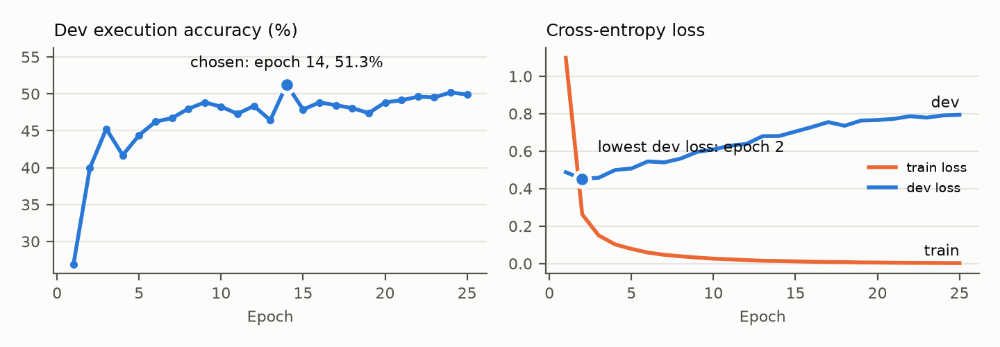

# Introduction to the NLP Task

## Motivation
Most structured data in companies, hospitals and universities lives in relational databases. Querying them requires knowing SQL and the exact table and column names of each database. Text-to-SQL removes this barrier: given the question *"How many singers are from France?"* and a database, the system writes `SELECT count(*) FROM singer WHERE country = 'France'`, runs it and returns the answer. Non-programmers can then ask questions of their data directly.

## Core challenges
1. **Schema linking.** Question words must be matched to the right tables and columns, which rarely share the same spelling ("singers" → table `singer`, "older than 30" → column `Age`).
2. **Structure.** Many questions need joins across tables, grouping, ordering, nested queries or set operations.
3. **Unseen databases.** Spider's test databases never appear in training, so a model must read the schema it is given rather than memorise names.
4. **Executability.** A single wrong column name makes SQLite reject the whole query, so an almost-correct query still scores zero.

## Formulation
Given a question $Q$ and a database schema $S$ (tables, columns and foreign keys), produce the SQL query $Y$ that answers $Q$. All our neural models generate $Y$ one token at a time, choosing at each step a likely next token given the question, the schema and the tokens written so far:
$$\hat{Y}=\arg\max_Y \prod_{t=1}^{n} P(y_t\mid y_{<t},Q,S).$$


# Literature Survey: Why the Problem Matters

**Rule-based systems.** PRECISE (Popescu et al., 2003) maps question words to database elements with hand-written rules and is very precise on questions it accepts, but fails on anything outside its patterns. Grammar-based parsers (Zettlemoyer and Collins, 2005; Wong and Mooney, 2007) need a hand-built lexicon for every new domain.

**Neural sequence-to-sequence models.** LSTM encoder–decoders (Hochreiter and Schmidhuber, 1997; Sutskever et al., 2014) with attention (Bahdanau et al., 2015) treat Text-to-SQL as translation. Pointer networks (Vinyals et al., 2015; See et al., 2017) let the decoder copy table names and values from the input. On WikiSQL, Seq2SQL (Zhong et al., 2017) and SQLNet (Xu et al., 2017) fill SQL sketches. On Spider these models reach only 4–12% exact match (Yu et al., 2018), mostly because they cannot link question words to unseen schemas. Our Part 2 baselines belong here.

**Pre-trained transformers.** The transformer (Vaswani et al., 2017) replaces recurrence with self-attention. T5 (Raffel et al., 2020) is a transformer encoder–decoder pre-trained on a large web corpus; fine-tuned on Spider with the schema written into the input, it became a strong and simple baseline (Shaw et al., 2021). Relation-aware encoders such as RAT-SQL (Wang et al., 2020) model links between question words and schema items. PICARD (Scholak et al., 2021) showed that *constraining decoding*, rejecting invalid partial SQL during beam search, adds several points to T5, and RESDSQL (Li et al., 2023) ranks schema items before decoding. Our novelty follows PICARD's idea in a lighter form.

**Large language models (LLMs).** Instruction-tuned LLMs write SQL from a prompt with no task-specific training. DIN-SQL (Pourreza and Rafiei, 2023) and DAIL-SQL (Gao et al., 2024) prompt GPT-4 with the schema written as `CREATE TABLE` statements and a few solved examples, reaching about 85% execution accuracy on Spider. Feeding execution errors back to the model ("self-debugging"; Chen et al., 2024) is a common addition. We use the open-weight gpt-oss-20b (OpenAI, 2025) since hosted APIs were not available to us.

**Why it matters.** Natural-language access to databases is one of the most practical applications of NLP, and Spider's unseen-database split tests exactly the generalisation that real users need.


# Dataset

## Datasets and splits

| | Spider (Yu et al., 2018) | WikiSQL (Zhong et al., 2017) |
|---|---|---|
| Domain | 138 domains (college, business, sport, entertainment, ...) | Wikipedia tables (open domain) |
| Source and licence | `yale-lily.github.io/spider` (CC BY-SA 4.0) | `github.com/salesforce/WikiSQL` (BSD-3) |
| Size | 7,000 train / 1,034 dev / 2,147 test questions | 56,355 train / 8,421 dev / 15,878 test |
| Databases | 140 / 20 / 40, no overlap between splits (verified) | One table per question |
| SQL operations | Joins, `GROUP BY`, `HAVING`, `ORDER BY`, nesting, set operations | `SELECT`, one aggregate, `AND` conditions |
| Role here | Main benchmark, all models | Part 2 LSTM warm-up and single-table sanity check |

**Why these datasets.** Spider is the standard benchmark for multi-table Text-to-SQL on unseen databases, and every question ships with an executable SQLite database, so predictions can be checked by running them. WikiSQL is large and simple, which made it a useful warm-up for the LSTM.

**Spider statistics.** Spider labels each question by difficulty. Dev has 248 easy, 446 medium, 174 hard and 166 extra-hard questions; test has 470 / 857 / 463 / 357. By structure, dev has 544 single-table, 438 multi-table (join or set operation) and 52 nested questions; test has 1,100 / 908 / 139. All 7,000 / 1,034 / 2,147 Spider questions load without exclusions.

## Preprocessing

**Schema serialisation for T5.** The question and the database schema are joined into one line: the question, the database name, then each table with its columns, then the foreign keys. This is the real input for dev question 4 (198 tokens):

```text
What is the average, minimum, and maximum age of all singers from France? | concert_singer
| concert : Stadium_ID , Theme , Year , concert_ID , concert_Name
| singer : Age , Country , Is_male , Name , Singer_ID , Song_Name , Song_release_year
| singer_in_concert : Singer_ID , concert_ID | stadium : ... | fk : concert.Stadium_ID -> stadium.Stadium_ID ...
```

**Tokenisation.** T5 uses a SentencePiece sub-word vocabulary (32,000 pieces), so a rare name is split into known pieces instead of becoming an unknown word: `singers` → `▁singer` `s`, `concert_singer` → `▁concert` `_` `s` `inger`. No lower-casing, stemming or stop-word removal is applied, because table names, values and SQL keywords must be reproduced exactly.

**Fixing the vocabulary.** T5's vocabulary has no `<` character. With the original tokenizer, `WHERE age < 30` becomes `... ▁age ▁ <unk> ▁30`, so the model could never write "less than". This affected **320 of 7,000 training** and **42 of 1,034 dev** gold queries. We added `<` and `<=` as new tokens (and enlarged T5's embedding table to match) before fine-tuning; afterwards no gold query contains an unknown token and the same SQL becomes `... ▁age < ▁30`.

| Spider split | Questions | Input tokens (mean / max) | Inputs over 512 tokens | SQL tokens (mean / max) |
|---|---:|---:|---:|---:|
| Train | 7,000 | 352 / 2,255 | 1,669 (24%) | 44 / 245 |
| Dev | 1,034 | 246 / 776 | 78 (8%) | 42 / 160 |
| Test | 2,147 | 251 / 872 | 196 (9%) | 45 / 249 |

Inputs longer than 512 tokens are truncated, which cuts off the last tables of very large schemas (a limitation discussed in §e).

**Prompt format for the LLM.** gpt-oss-20b instead receives the schema as SQL `CREATE TABLE` statements with primary and foreign keys and three example rows per table, following DAIL-SQL (Gao et al., 2024):

```text
CREATE TABLE "singer" ( "Singer_ID" INTEGER, "Name" TEXT, "Country" TEXT, "Age" INTEGER, ...
  PRIMARY KEY ("Singer_ID") );
/* 3 example rows: Singer_ID | Name | Country | Age ...  1 | Joe Sharp | Netherlands | 52 ... */
Question: What is the average, minimum, and maximum age of all singers from France?
```

## Dataset limitations
Spider is English-only and skewed towards college, business and entertainment schemas. Dev has only 20 databases, so results vary strongly by database. Most queries appear with two paraphrased questions. Small databases allow a wrong query to return the right answer by coincidence (an example appears in §e). Gold SQL follows inconsistent conventions (quoting, capitalisation, trailing semicolons), and one training query refers to a table missing from its database. Difficulty is imbalanced: 43% of dev is medium and 16% extra-hard.


# Method

## Classical baselines (Part 2)

**Template parser.** Hand-written rules match question words to the table and columns of one table, detect values (numbers, quoted names), comparison phrases ("older than" → `>`), aggregation cues ("how many" → `COUNT`, "average" → `AVG`) and ordering cues, and fill a single-table `SELECT ... FROM ... WHERE ... ORDER BY` template. It never joins tables, and returns nothing when it cannot match a question confidently (8.9% of dev questions).

**Pointer-generator LSTM.**

| Component | Setting |
|---|---|
| Encoder | 2-layer bidirectional LSTM, embedding 256, hidden 256 per direction |
| Decoder | 2-layer LSTM, hidden 512, additive attention over the encoder states |
| Copy mechanism | A learned gate mixes "generate a word from the vocabulary" with "copy a word from the input" |
| Vocabulary | 102,463 word types from training data; word-level embeddings |
| Training | Adam, learning rate 1e-3, batch 64, dropout 0.2; WikiSQL 10 epochs, then Spider 25 epochs |
| Decoding | Greedy, at most 128 tokens, then rendering and schema-aware repair |

*How its weights were learned.* Every weight, including the word embeddings, started as a small random number. For each training example the model predicted the gold SQL one token at a time; the loss was how improbable it found the correct token (cross-entropy). Backpropagation computed how each weight should change to reduce that loss, and the Adam optimiser applied the change. Repeating this over all examples for several epochs gives the trained weights. Nothing was pre-trained or frozen.

## Modern model 1: fine-tuned T5-base

**Architecture.** T5-base (Raffel et al., 2020) is a transformer encoder–decoder with 220 million parameters. The encoder (12 layers) reads the whole input; the decoder (12 layers) writes the SQL token by token. Each layer uses **self-attention**: every token computes a weighted average over all other tokens, with weights based on how relevant they are, so the word "singers" can directly attend to the column `singer` anywhere in the schema. This replaces the LSTM's step-by-step recurrence, which had to carry information through every position. The decoder also attends to the encoder's output, like the LSTM's attention. Each layer has 12 attention heads and a feed-forward block; the model dimension is 768. Positions are encoded as relative distances.

**How its weights are learned.** Unlike the LSTM, T5 does not start from random weights. Google pre-trained it on a large English web corpus (C4) by hiding random spans of text and training it to fill them in, so it already understands English and some code. We start from that checkpoint and **fine-tune**: we show it (question + schema → gold SQL) pairs and update **all** its weights by backpropagation to make the gold SQL more probable, using the same cross-entropy loss as the LSTM. Only the embeddings of the two new tokens (`<`, `<=`) start from scratch. Because fine-tuning adjusts knowledge the model already has, T5 learns far more from Spider's 7,000 examples than the LSTM could.

**Why T5.** It is the standard pre-trained baseline for Spider, takes the schema as plain text, needs no task-specific architecture, and fits in half a GPU for training.

| Setting | Value |
|---|---|
| Checkpoint | `google-t5/t5-base` (220M parameters, all trainable, none frozen) |
| Training data | Spider train, 7,000 questions |
| Max input / output length | 512 / 256 tokens |
| Optimiser | AdamW, learning rate 3e-4, linear decay with 5% warm-up, gradient clipping 1.0 |
| Batch size, epochs, seed | 16, 25 epochs (about 36 minutes), seed 42 |
| Checkpoint selection | Epoch with the best dev execution accuracy, measured after every epoch (epoch 14) |
| Decoding | Beam search with 4 or 8 beams |

## Modern model 2: gpt-oss-20b (instruction-tuned LLM)

gpt-oss-20b (OpenAI, 2025) is an open-weight transformer **decoder** (24 layers, 21 billion parameters). It is a mixture-of-experts model: each layer has 32 expert feed-forward blocks and uses only 4 per token, so about 3.6 billion parameters are active for each token. It was pre-trained on large text and code corpora and then trained to follow instructions and reason before answering. **We do not train it**: all its weights stay frozen and the task is given entirely in the prompt (in-context learning).

| Setting | Value |
|---|---|
| Prompt | Instruction + schema as `CREATE TABLE` with keys + 3 sample rows per table + question |
| Few-shot examples | 0 or 3, the most similar Spider train questions (word-overlap cosine), always from other databases |
| Decoding | Greedy, at most 1,024 new tokens, reasoning effort "low"; SQL extracted from the reply |
| Error feedback (B) | Up to 2 retries with the SQLite error message |
| Precision | bfloat16 (about 42 GB); the faster 4-bit kernels could not be compiled on the HPC |

**Why gpt-oss-20b.** It represents the current generation (instruction-tuned LLMs, as allowed by the course brief), its weights are public so results are reproducible, and it fits on our HPC GPU.

## Our contribution: schema-constrained decoding (A) and execution-guided reranking (B)

**Motivation.** With T5 as with the LSTM, the main error is **schema linking**: on Spider dev, 317 of T5's 1,034 queries (31%) do not run, and 275 of those fail with "no such column". Beam search already produces several candidate queries per question, and a lower-ranked candidate is often correct. A and B choose a better candidate. Neither needs retraining; both work on the trained T5.

**A: schema-constrained beam search.** Beam search keeps the *k* most probable partial queries at each step.

1. Before decoding, build the set of allowed words: SQL keywords, every table and column name of *this* database, table aliases (`T1`, `T2`, ...), aliases the query itself declares (`AS total`), numbers, and the words of the question (for unquoted values).
2. At every decoding step, look at each beam's last *completed* word. If it is not allowed, discard the beam (set all its next-token scores to minus infinity). A word still being written is not judged, and text inside quotes (values) is never checked.
3. When decoding ends, check each finished candidate with SQLite `EXPLAIN`, which compiles the query without running it and fails on unknown tables or columns and on syntax errors. Return the first candidate that compiles, or the top beam if none does.

**B: execution-guided reranking.** Run the *k* candidates in order on the database (read-only, 5-second limit each). Return the first that runs and returns rows; if none returns rows, the first that runs; if none runs, the top beam. An empty result is treated only as weaker evidence than a non-empty one, never as proof of correctness. For the LLM, which produces one answer rather than a beam, B instead sends the SQLite error back to the model and asks for a corrected query, at most twice.

**A + B** applies B to the candidates that survive A.

*Example (concert_singer).* For "List singer names and number of concerts for each singer", plain T5 writes `... FROM concert AS T1 JOIN singer AS T2 ON T1.singer_id = T2.singer_id ...`, which fails because `concert` has no `singer_id`. With A + B the chosen candidate joins `singer_in_concert` and is correct.

**What is new.** PICARD constrains T5 with a full incremental SQL parser. Ours needs no parser: it checks completed words against the schema, then relies on SQLite itself (`EXPLAIN`, then execution) to judge whole queries. It is simple, works with any seq2seq model and any SQLite database, and directly targets the schema-linking errors found in our error analysis.

| Hyperparameter | Value |
|---|---|
| Beams *k* (candidates kept) | 8 |
| Constraint check | Every decoding step, completed bare words only |
| Final check | SQLite `EXPLAIN` on finished candidates |
| Rerank | First candidate that executes with rows, 5-second limit |
| LLM correction retries | 2 |

*Check that A never blocks correct SQL.* Applied to the gold queries themselves, the constraint rejects 0 of 1,034 dev and 1 of 7,000 train queries; that one names a table missing from its database (a Spider annotation error).

## Implementation
Python 3.12, PyTorch 2.14, Hugging Face Transformers 5.20, SQLite (read-only connections) and the official Spider evaluator; training and decoding ran as Slurm jobs on the BITS HPC, and evaluation and the demo run on a laptop. The environment is pinned with `uv`; 106 unit tests cover data loading, the models, the constraint, the reranker and the metrics.

# Experiments

## Set up
All systems answer the same questions and are scored by the same evaluator. Every choice (checkpoint, beam size, prompts) was made on Spider dev. The Spider test set (2,147 questions, 40 databases never used for any decision) was run **once**, at the end. Each LLM setting and the T5 ablation was run as a separate HPC job.

## Metrics
- **Execution accuracy (EX).** Run the predicted and gold SQL on the database and compare the results (as a multiset of rows; order matters only if the gold query has `ORDER BY`). This is the most meaningful metric: it rewards any query that gets the right answer, however it is written. *Limitation:* a wrong query can return the right rows by coincidence on a small database.
- **Exact-set match (EM).** Compare each clause of the predicted and gold query (`SELECT`, `WHERE`, `GROUP BY`, ...) as sets, ignoring values. *Limitation:* a correct query written differently (an alias, a `LEFT JOIN`, a subquery instead of a join) counts as wrong.
- **Invalid-SQL rate.** Share of predictions that fail to run, split by SQLite error type. It shows directly whether the model respects the schema.

BLEU-style text-overlap metrics are not used: two queries can share most tokens yet return different answers. EX and EM come from the official Spider evaluator. For significance we report a 95% confidence interval that resamples whole databases (questions on the same database are correlated) and McNemar's test on paired per-question outcomes.

## Baselines
Classical: template parser and pointer-generator LSTM. Modern: T5-base with beam search; gpt-oss-20b zero-shot and few-shot. Ours: T5-base + A, + B and + A + B, and gpt-oss-20b + B (error feedback).

## Evaluation, Results and Discussion

**Main results (official evaluator).**

| System | Type | Dev EX | Dev EM | Test EX | Test EM |
|------------------------------|------------------------|--------:|--------:|--------:|--------:|
| Template parser | Rules | 9.9% | 5.9% | 9.5% | 6.7% |
| Pointer-generator LSTM | Classical neural | 8.1% | 5.0% | 7.2% | 5.5% |
| T5-base, beam | Fine-tuned transformer | 54.1% | 52.1% | 53.4% | 49.6% |
| **T5-base + A + B (ours)** | Fine-tuned + novelty | **64.4%** | **59.5%** | **62.4%** | **56.7%** |
| gpt-oss-20b, 0-shot | LLM, no training | 78.6% | 20.1% | — | — |
| gpt-oss-20b, 0-shot + B | LLM + error feedback | 78.7% | 20.1% | — | — |
| gpt-oss-20b, 3-shot | LLM, no training | 81.2% | 32.5% | [TEST] | [TEST] |


The table shows how the field has moved. Rules and LSTMs answer fewer than one question in ten; fine-tuning a pre-trained transformer answers over half; our decoding raises that to about two thirds; an instruction-tuned LLM answers about four in five with no task-specific training.

**Ablation of A and B (T5-base, 8 beams, official evaluator).**

| Decoding | Dev EX | Dev EM | Dev invalid | Test EX | Test EM | Test invalid |
|---|---:|---:|---:|---:|---:|---:|
| Beam search (baseline) | 54.1% | 52.1% | 30.7% | 53.4% | 49.6% | 30.8% |
| + A, pruning only | 55.1% | 52.9% | 28.2% | 55.4% | 51.2% | 27.6% |
| + A, pruning + `EXPLAIN` check | 63.4% | 58.9% | 13.1% | 61.0% | 56.0% | 15.3% |
| + B, execution rerank | 63.0% | 58.6% | 15.7% | 61.4% | 55.8% | 17.7% |
| **+ A + B** | **64.4%** | **59.5%** | **13.1%** | **62.4%** | **56.7%** | **15.3%** |

- **The improvement holds on unseen databases.** On the test set, A + B improves EX by **9.0 points** (95% CI [7.3, 10.9]; McNemar p < 10^-50^) and EM by 7.1 points, fixing 196 questions and breaking 3. On dev the gain was 10.3 points (CI [7.5, 13.3]; 110 fixed, 3 broken). The rise in EM shows the SQL is genuinely better, not just luckier.
- Most of A's gain comes from the final `EXPLAIN` check. Pruning during the search alone adds 1–2 points (significant on test, not on dev).
- A and B are about equally strong alone (test difference 0.4 points, p = 0.56), and **A + B beats each of them** on test (+1.4 over A, +1.0 over B, both p < 10^-4^), so the two steps catch partly different errors.

**By difficulty (official EX).**

| System | Split | Easy | Medium | Hard | Extra | All |
|---|---|---:|---:|---:|---:|---:|
| T5-base, beam | dev | 77.8% | 56.5% | 39.1% | 27.7% | 54.1% |
| T5-base + A + B | dev | 83.5% | 70.6% | 51.1% | 33.1% | 64.4% |
| gpt-oss-20b, 0-shot | dev | 90.7% | 83.6% | 71.8% | 54.2% | 78.6% |
| T5-base, beam | test | 79.4% | 54.8% | 40.6% | 32.5% | 53.4% |
| T5-base + A + B | test | 83.6% | 65.9% | 49.0% | 43.4% | 62.4% |

A + B helps most on medium, hard and extra-hard questions (+8 to +14 points), which typically involve joins; easy questions gain 4–6 points.

**By query structure (dev, strict EX).** A + B lifts multi-table questions from 25.6% to 39.7% (+14.1) but single-table ones only from 68.2% to 73.5% (+5.3): join queries name more tables and columns, so they have more chances to name a wrong one.

**gpt-oss-20b: examples and error feedback.** Three solved examples in the prompt raise EX from 78.6% to 81.2% and EM from 20.1% to 32.5%: the examples show the model Spider's SQL style, which it then imitates, confirming that its low EM is about style rather than correctness. Since 3-shot was best on dev, it is the setting run on test. The LLM writes almost no invalid SQL (8 of 1,034), so feeding errors back fixes little: invalid SQL drops to 0 but EX rises only 0.1 points. Option B is valuable for models that make schema errors, like T5, not for one that rarely does.

**Training dynamics (T5-base).** Training loss falls steadily, but dev loss is lowest at epoch 2 and then rises, while dev accuracy keeps improving until about epoch 14. The model grows more confident on wrong tokens (raising loss) while getting more queries right, so we select the checkpoint by accuracy, not loss.

{ width=80% }

## Error analysis

**Outcome by difficulty (Spider test, T5-base).** Every question ends in one of three outcomes: correct, ran but returned the wrong answer, or invalid (did not run).

| Difficulty | Questions | Beam: correct / wrong / invalid | A + B: correct / wrong / invalid |
|---|---:|---:|---:|
| Easy | 470 | 373 / 47 / 50 | 393 / 64 / 13 |
| Medium | 857 | 470 / 138 / 249 | 565 / 189 / 103 |
| Hard | 463 | 188 / 92 / 183 | 227 / 129 / 107 |
| Extra hard | 357 | 116 / 61 / 180 | 155 / 97 / 105 |
| **All** | **2,147** | **1,147 / 338 / 662** | **1,340 / 479 / 328** |

A + B halves the invalid queries (662 → 328). Of the 334 queries it rescues, 193 become correct and 141 run but give the wrong answer, so the remaining errors shift from "does not run" to "wrong meaning".

| Failure type (dev, out of 1,034) | T5 beam | T5 + A + B | gpt-oss 0-shot |
|----------------------------------------|----------:|----------:|----------:|
| Query does not run | 317 | 135 | 8 |
| ... "no such column" | 275 | 123 | 3 |
| ... "no such table" | 21 | 7 | 0 |
| Runs, but wrong tables | 44 | 80 | 69 |
| Runs, but wrong columns | 68 | 98 | 114 |
| Runs, but wrong clause structure | 20 | 31 | 68 |
| Runs, but wrong values | 12 | 11 | 67 |

**Recurring patterns.**

- **Schema linking dominates T5's errors.** Most invalid queries reference columns that exist in a *different* table, e.g. `ORDER BY age` in `pets` when `age` is a student column and the pet column is `pet_age`. A + B removes 55% of them.
- **Valid but wrong.** A + B turns many crashing queries into ones that run, but some of those now use the wrong table or column. Execution checks cannot detect a query that runs but answers a different question; this is the method's main limit.
- **Long schemas.** 24% of training inputs exceed T5's 512-token limit and lose their last tables, so the model learns less about large databases.
- **gpt-oss fails on meaning, not syntax.** Its errors are wrong values, extra columns and different conventions. Its EM (20.1%) is far below its EX (78.6%) because it writes correct SQL in its own style, e.g. `COUNT(*) AS total_singers`, `LEFT JOIN`, explicit table aliases, which exact match counts as wrong.

**Qualitative examples.**

1. *"How much does the youngest dog weigh?"* (pets_1). Beam: `ORDER BY age` (no such column in `pets`). A + B: `ORDER BY pet_age`, correct.
2. *"Which of the countries has the most car makers?"* (car_1). Beam reads `CountryName` from `car_makers`, where it does not exist. A + B joins `countries` and is correct.
3. *"Show the stadium name and the number of concerts in each stadium."* gpt-oss writes a `LEFT JOIN`, which also lists stadiums with zero concerts. It is a reasonable reading of the question, but differs from the gold answer, which uses an inner join; the benchmark's conventions affect the score.
4. *A coincidental match.* For "the student who has a cat that is age 3" (pets_1), A + B's query drops the "cat" condition but still returns the right student, because the only 3-year-old pet in the database is a cat. EX counts it correct; EM does not.

**Mitigation.** Ranking schema items before decoding (as RESDSQL does) would shorten long inputs and give the model fewer wrong names to choose from; checking a query's meaning, for example by asking a second model whether the result answers the question, could catch valid-but-wrong queries.

## Challenges

| Stage | Challenge | How we solved it |
|---|---|---|
| Tokenisation | T5's vocabulary has no `<`, so 320 training queries could never be generated correctly | Added `<` and `<=` as new tokens before fine-tuning |
| Model selection | Dev *loss* was best at epoch 2, but that model still wrote broken SQL (41% EX) | Selected the checkpoint by dev *execution accuracy* after every epoch (epoch 14, 51%) |
| Long inputs | 24% of training schemas exceed 512 tokens | Kept truncation; noted as a limitation (schema ranking is the fix) |
| LLM on the HPC | gpt-oss's 4-bit kernels need C headers missing on the cluster | Loaded the model in 16-bit precision (about 42 GB) |
| Shared GPUs | Few-shot prompts ran out of memory when other users shared the card | Smaller batches, a memory-allocator setting, and splitting the run into halves |
| Cluster limits | One GPU job per user and a 2-hour time limit | One job per setting; checkpoint saved after every improving epoch |
| Live demo | The HPC queue can delay live training during the viva | Demo trains t5-small on the laptop (about 3 minutes), with the HPC run as an option |
| Fair evaluation | Dev chose the checkpoint and settings, so dev scores are optimistic | Final claims use the test set, run once |


# Conclusion

On one benchmark with one evaluator, accuracy rises from under 10% with rules and LSTMs, to 54% by fine-tuning a pre-trained T5-base, and to 79% with a 20-billion-parameter LLM used without any training. This tracks the field's shift from hand-written rules, to models trained from scratch, to pre-trained models adapted with little or no task data.

Our contribution, schema-constrained beam search plus execution-guided reranking, adds 9.0 points to T5-base on the held-out Spider test set (10.3 on dev) without retraining by fixing its dominant error: references to tables and columns that do not exist. It is simple, works with any seq2seq model and any SQLite database, and helps most on join queries. It cannot fix queries that run but answer the wrong question, and it adds little to an LLM that rarely writes invalid SQL. Exact match proved unsuitable for judging LLM output, so execution accuracy should be the primary metric. Natural next steps are schema ranking before decoding and checking whether a query's result actually answers the question.


# References {-}

\footnotesize

- Bahdanau, D., Cho, K., Bengio, Y. (2015). Neural machine translation by jointly learning to align and translate. *ICLR*.
- Chen, X., Lin, M., Schärli, N., Zhou, D. (2024). Teaching large language models to self-debug. *ICLR*.
- Gao, D., Wang, H., Li, Y., et al. (2024). Text-to-SQL empowered by large language models: a benchmark evaluation. *VLDB*.
- Hochreiter, S., Schmidhuber, J. (1997). Long short-term memory. *Neural Computation*.
- Li, H., Zhang, J., Li, C., Chen, H. (2023). RESDSQL: decoupling schema linking and skeleton parsing for Text-to-SQL. *AAAI*.
- McNemar, Q. (1947). Note on the sampling error of the difference between correlated proportions or percentages. *Psychometrika*.
- OpenAI (2025). gpt-oss-120b and gpt-oss-20b model card.
- Popescu, A.-M., Etzioni, O., Kautz, H. (2003). Towards a theory of natural language interfaces to databases. *IUI*.
- Pourreza, M., Rafiei, D. (2023). DIN-SQL: decomposed in-context learning of Text-to-SQL with self-correction. *NeurIPS*.
- Raffel, C., Shazeer, N., Roberts, A., et al. (2020). Exploring the limits of transfer learning with a unified text-to-text transformer. *JMLR*.
- Scholak, T., Schucher, N., Bahdanau, D. (2021). PICARD: parsing incrementally for constrained auto-regressive decoding from language models. *EMNLP*.
- See, A., Liu, P. J., Manning, C. D. (2017). Get to the point: summarization with pointer-generator networks. *ACL*.
- Shaw, P., Chang, M.-W., Pasupat, P., Toutanova, K. (2021). Compositional generalization and natural language variation: can a semantic parsing approach handle both? *ACL*.
- Sutskever, I., Vinyals, O., Le, Q. V. (2014). Sequence to sequence learning with neural networks. *NeurIPS*.
- Vaswani, A., Shazeer, N., Parmar, N., et al. (2017). Attention is all you need. *NeurIPS*.
- Vinyals, O., Fortunato, M., Jaitly, N. (2015). Pointer networks. *NeurIPS*.
- Wang, B., Shin, R., Liu, X., Polozov, O., Richardson, M. (2020). RAT-SQL: relation-aware schema encoding and linking for Text-to-SQL parsers. *ACL*.
- Wong, Y. W., Mooney, R. (2007). Learning synchronous grammars for semantic parsing with lambda calculus. *ACL*.
- Xu, X., Liu, C., Song, D. (2017). SQLNet: generating structured queries from natural language without reinforcement learning. *arXiv:1711.04436*.
- Yu, T., Zhang, R., Yang, K., et al. (2018). Spider: a large-scale human-labeled dataset for complex and cross-domain semantic parsing and Text-to-SQL task. *EMNLP*.
- Zettlemoyer, L., Collins, M. (2005). Learning to map sentences to logical form. *UAI*.
- Zhong, R., Yu, T., Klein, D. (2020). Semantic evaluation for Text-to-SQL with distilled test suites. *EMNLP*.
- Zhong, V., Xiong, C., Socher, R. (2017). Seq2SQL: generating structured queries from natural language using reinforcement learning. *arXiv:1709.00103*.
